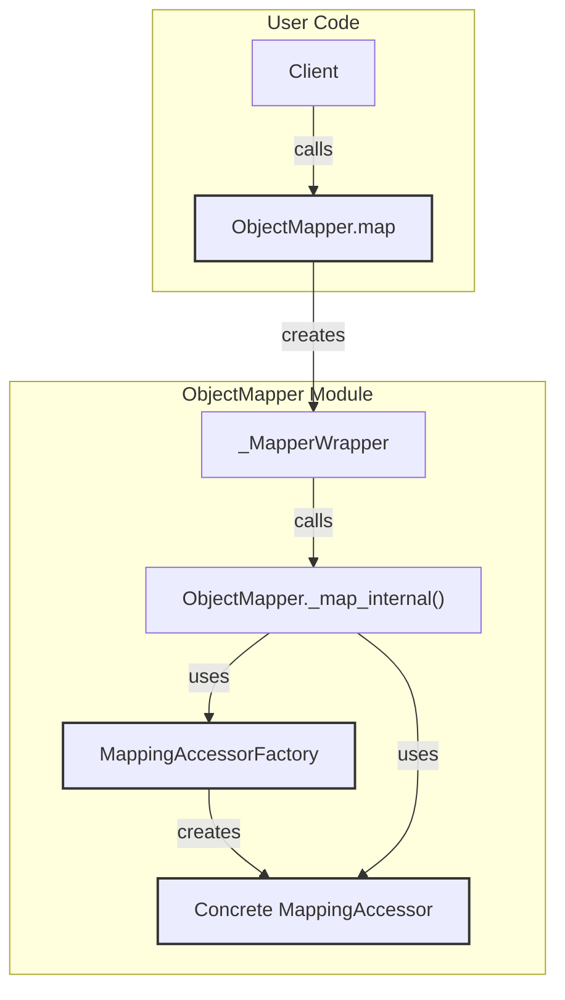

# 2. Architecture and Design Patterns

The module's architecture is built upon several key design patterns to achieve its flexibility and extensibility.

## Core Design Patterns

- **Factory Pattern**: The `MappingAccessorFactory` is central to the design. It is responsible for creating the appropriate "accessor" object for a given source or target object. It inspects the object's type and decides which concrete accessor class to instantiate. This decouples the main mapping logic from the specifics of how to interact with different data structures.

- **Strategy Pattern**: Each concrete `MappingAccessor` (e.g., `DictInstanceAccessor`, `PydanticObjectInstanceAccessor`) acts as a distinct strategy for accessing data. The `ObjectMapper`'s internal logic uses the factory to select the correct strategy at runtime, allowing it to uniformly handle objects, dictionaries, and lists through a common `MappingAccessor` interface.

- **Template Method Pattern**: This pattern is used within the object accessor hierarchy. The `ObjectAccessorMixin` defines the skeleton of the algorithm for accessing an object's properties (e.g., `get_fields`, `get_field_type`). Concrete subclasses, like `PydanticObjectMixin` or `SqlAlchemyObjectMixin`, implement the specific steps of this algorithm, providing the details for how to get fields and types from a Pydantic model or a SQLAlchemy model, respectively.

## High-Level Interaction Diagram

This diagram illustrates the main flow when a mapping operation is performed.

