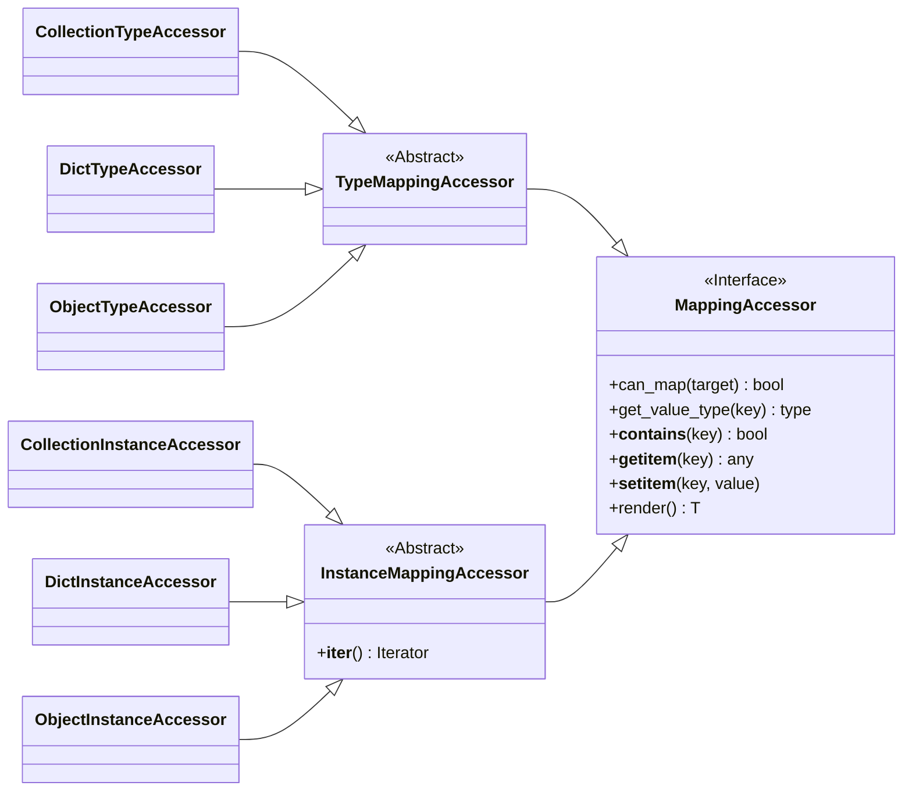
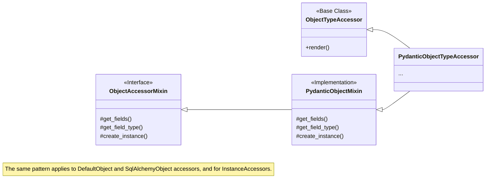

# 3. Class Hierarchy

The power of the module comes from its composable and layered class structure, primarily revolving around the `MappingAccessor` abstract base class.

## `MappingAccessor` Inheritance

There are two main branches of accessors:

1. **`TypeMappingAccessor`**: Used when mapping *to a type* (creating a new instance). It builds up the data internally and uses a `render()` method to create the final object.
2. **`InstanceMappingAccessor`**: Used when mapping *from an instance* (reading data) or updating an existing instance. It reads data from the provided object instance.

This diagram shows the main branches of the accessor hierarchy.

## `ObjectAccessor` Specialization (Template Method)

For handling object-like structures, a specialized mixin-based approach is used. The `ObjectAccessorMixin` defines the interface, and concrete mixins implement it for different object frameworks.

